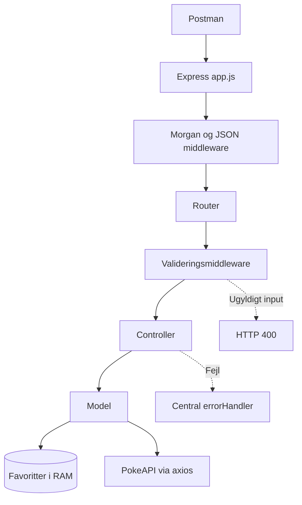

# Pokémon API – REST, arkitektur og integration

Eksempelprojekt til Programmering 2, uge 44. **Komplet lokal CRUD** for favoritter og **ekstern integration** med PokeAPI. Node.js 18+.

## Start

```bash
npm install
npm start
```

Server: `http://localhost:3000`. Test lokal CRUD med `npm test` (kræver ikke netværksforbindelse til PokeAPI).

## Arkitektur



- `app.js`: konfiguration og rækkefølge af middleware.
- `routes/`: URL, HTTP-metode og valideringsmiddleware.
- `controllers/`: HTTP-status og JSON-response.
- `models/`: data i RAM eller kald til PokeAPI.
- `middleware/`: validering og fejlhåndtering.

## Postman – afprøv i denne rækkefølge

| Metode | URL | Body | Forventet |
|---|---|---|---|
| GET | `/pokemon/pikachu` | – | 200: Pokémon-data fra PokeAPI |
| GET | `/pokemon/pikachu!` | – | 400: ugyldigt navn, controller kaldes ikke |
| GET | `/pokemon/ukendtpokemon123` | – | 404 fra PokeAPI, oversat af fejlhåndtering |
| GET | `/favorites` | – | 200, først `[]` |
| POST | `/favorites` | `{"name":"Pikachu","note":"Min favorit"}` | 201 og genereret id |
| POST | `/favorites` | `{"name":""}` | 400, afvist af middleware |
| GET | `/favorites/1` | – | 200 med favoritten |
| PUT | `/favorites/1` | `{"name":"Eevee","note":"Opdateret"}` | 200, samme id |
| DELETE | `/favorites/1` | – | 204, tom response |
| GET | `/favorites/1` | – | 404 efter sletning |

Brug `http://localhost:3000` foran alle URL'er. Vælg **Body → raw → JSON** ved POST og PUT. Favoriternes ID'er afhænger af rækkefølgen, du opretter dem i.

## Undersøg i grupper

1. Spor `GET /pokemon/pikachu` fra Postman gennem router, controller og model til PokeAPI.
2. Send ugyldig `POST /favorites`. Hvorfor bliver controlleren **ikke** kaldt?
3. Hvorfor bliver PokeAPI-fejl 404 eller 502 – og ikke altid 500?
4. Hvorfor forsvinder favoritdata ved genstart? Hvad ændrer MongoDB i uge 45?
5. Bed en AI-agent om at reviewe fejlhåndteringen **uden at ændre koden**. Undersøg forslaget og test efter en eventuel rettelse.

## Bemærk

Dette er et undervisningseksempel, ikke en fuld produktionsapplikation. Det har ingen login, vedvarende lagring eller samtidighedsbeskyttelse. Favoritter er uafhængige af eksterne Pokémon-opslag: `POST /favorites` validerer lokale felter, men spørger ikke PokeAPI om navnet findes.
